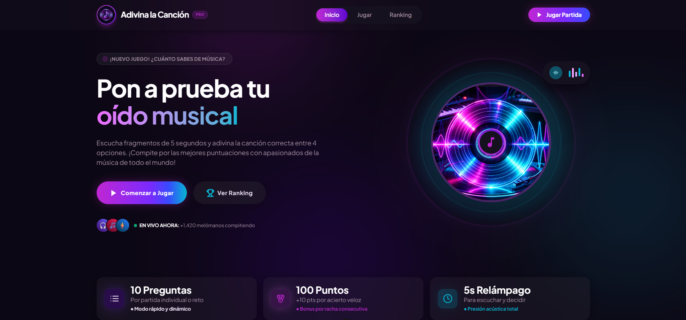
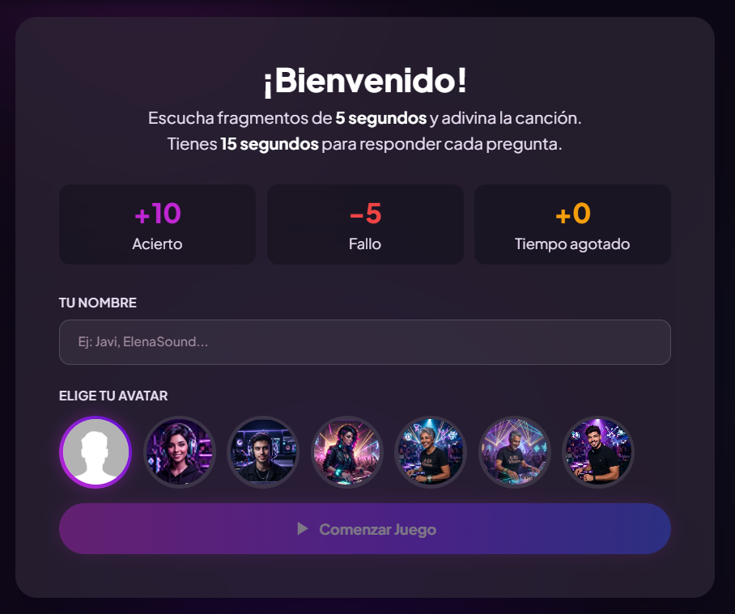
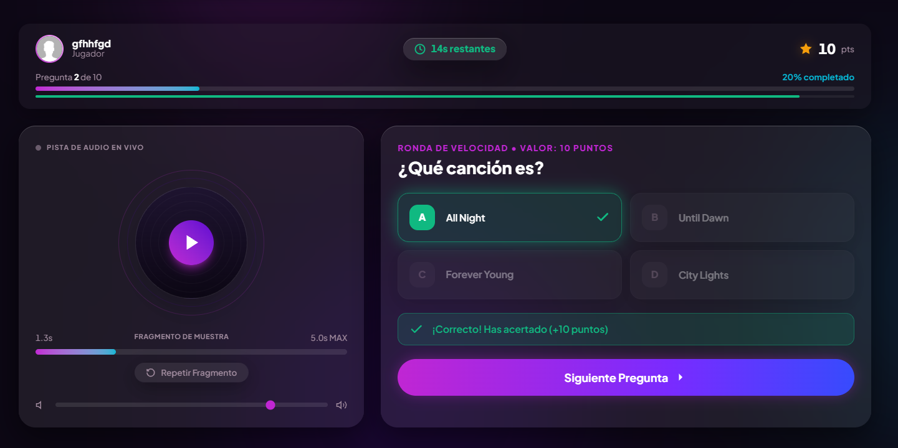
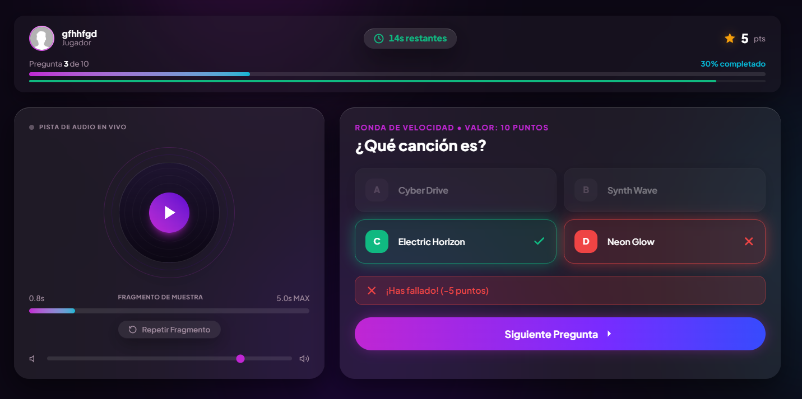
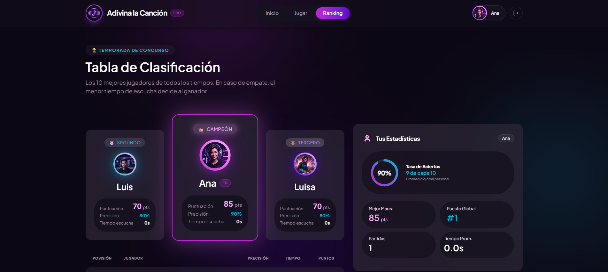

# Adivina la Canción

Aplicación web interactiva desarrollada con Vue 3 para poner a prueba los conocimientos musicales del jugador. La aplicación reproduce fragmentos de canciones, registra las respuestas y mantiene una clasificación local con las mejores puntuaciones.

## Demo

> **Nota:** sustituir los siguientes marcadores por las imágenes reales de la demo cuando estén disponibles.

### Página de inicio

<!-- PLACEHOLDER: añadir imagen de la página de inicio -->


### Login y selección de avatar

<!-- PLACEHOLDER: añadir imagen del formulario de login y selección de avatar -->


### Partida

<!-- PLACEHOLDER: añadir imagen de una partida en curso -->




### Ranking

<!-- PLACEHOLDER: añadir imagen de la vista de ranking -->


## Funcionalidades

- Landing page con información del juego y acceso a la partida.
- Login mediante nombre de jugador.
- Selección de uno de los cuatro avatares disponibles.
- Avatar asociado al usuario y mostrado en la navegación, la partida y el ranking.
- Diez preguntas por partida, seleccionadas aleatoriamente de un catálogo de canciones.
- Reproducción de fragmentos de cinco segundos aleatorios mediante Howler.js.
- Temporizador de quince segundos para responder cada pregunta.
- Sistema de puntuación:
  - `+10` puntos por respuesta correcta.
  - `-5` puntos por respuesta incorrecta.
  - `0` puntos si se agota el tiempo.
- Pantalla de resultados con precisión, aciertos y posición obtenida.
- Ranking con las diez mejores puntuaciones.
- Desempate por tiempo total de escucha y fecha de la partida.
- Persistencia de sesión y ranking mediante `localStorage`.
- El ranking puede consultarse como invitado.
- La partida requiere autenticación.
- El logout detiene y descarga el audio activo antes de cerrar la sesión.

## Tecnologías

- [Vue 3](https://vuejs.org/) con Composition API y `<script setup>`.
- [TypeScript](https://www.typescriptlang.org/).
- [Vite](https://vite.dev/).
- [Pinia](https://pinia.vuejs.org/) para el estado global.
- [Vue Router](https://router.vuejs.org/) para la navegación.
- [Howler.js](https://howlerjs.com/) para la reproducción de audio.
- [Tailwind CSS](https://tailwindcss.com/) para los estilos.

## Requisitos

- Node.js `22.18+` o `24.12+`.
- npm.

## Instalación

```sh
npm install
```

## Comandos disponibles

### Servidor de desarrollo

```sh
npm run dev
```

La aplicación estará disponible en la URL que muestre Vite, normalmente `http://localhost:5173`.

### Comprobación de tipos

```sh
npm run type-check
```

### Compilación para producción

```sh
npm run build
```

### Previsualización de producción

```sh
npm run preview
```

### Lint

```sh
npm run lint
```

## Estructura principal

```text
src/
├── assets/
│   └── img/                 # Avatares e imágenes de la interfaz
├── components/              # Componentes reutilizables
│   ├── game/                # Partida y resultados
│   ├── home/                # Página de inicio
│   └── ranking/             # Podio, tabla y estadísticas
│   └── login/               # Login
├── data/
│   └── songs.ts             # Catálogo de canciones
├── router/
│   └── index.ts             # Rutas y protección de la partida
├── stores/
│   ├── audio.ts             # Estado y ciclo de vida de Howler
│   ├── auth.ts              # Sesión y avatar del usuario
│   ├── game.ts              # Estado de la partida
│   └── ranking.ts           # Clasificación persistente
├── types/
│   └── game.ts              # Tipos del dominio
└── views/                   # Vistas asociadas a las rutas
```

## Rutas

| Ruta | Descripción | Acceso |
| --- | --- | --- |
| `/` | Página de inicio | Público |
| `/login` | Login y selección de avatar | Público |
| `/play` | Partida musical | Requiere autenticación |
| `/ranking` | Clasificación global | Público |

## Persistencia

La aplicación no necesita un backend para funcionar. Los datos se guardan en el navegador:

- `music_game_auth_user`: usuario autenticado, nombre, avatar y fecha de login.
- `concurso_musical_rankings`: partidas registradas en el ranking.

Para empezar con datos limpios, se pueden eliminar estas claves desde las herramientas de desarrollo del navegador.

## Licencia

Proyecto académico desarrollado para la práctica de Entorno Cliente del 2do año de CGS Desarrollo de Aplicaciones Web.
